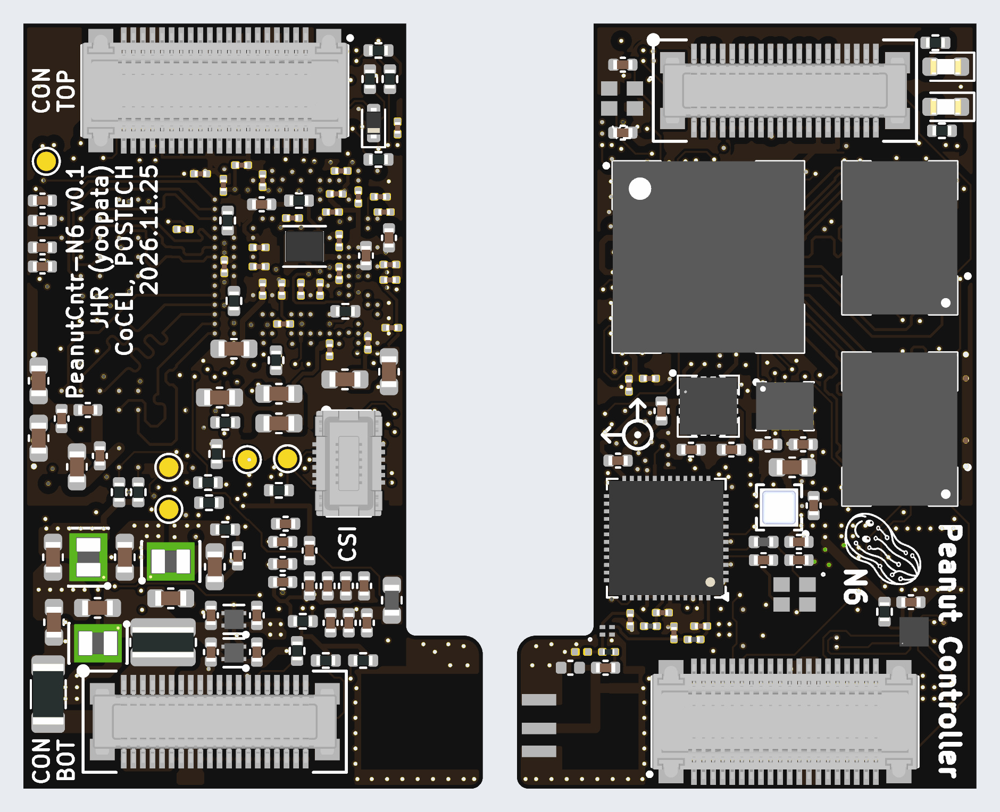

# Peanut Controller

**STM32N657L0 SoM for robotics applications with NN accelerator**

[Board Specification Spreadsheet](https://docs.google.com/spreadsheets/d/1FFwfozj1tVRQfzXSudWjYrMUlAaIKrv69ZutKTBa3as/edit?gid=110133492#gid=110133492)

## Specifications
- 8-layer PCB, 24×40x1 mm, 
- Processor:
    - STM32N6 MCU with Neural-ART accelerator
    - ESP32-C5HF4 for RF, connected to STM32 via UART
- Power:
    - Input: 3.5 ~ 4.3 V (LiPo) via `BAT_IN`
    - 3.3 V power output for external carrier and add-on boards via `3V3_AUX_OUT`
    - INA2227 monitors battery input and auxiliary output
- Onboard sensors:
    - IMU, Magnetometer, Barometer
- Interfaces via Board-to-Board connectors:
    - High speed: USB HS, Ethernet RMII, 2-lane MIPI CSI-2
    - Low speed: UART, I2C, SPI, FDCAN, DShot timer signals
    - Wireless: Wi-Fi 6 (2.4/5 GHz), BLE

## Detailed Specifications
### Processor
| MCU | Flash | RAM | Role | Description |
|-----|-----|-----|-----|-----|
| STM32N657L0H3Q | 128 MiB external OctoSPI NOR | 32 MiB external HexaSPI PSRAM | Main controller | Onboard Neural-ART accelerator |
| ESP32-C5HF4 | 4 MB in-package flash | 400 kB | RF companion | Dual-band Wi-Fi 6 |

### Connectivity
| Type | Name | Domain |
|----------|----------|----------|
| UART     | UART[1:6]  | J3 / J4 |
| SPI      | SPI[2:3]   | J1 / J2 |
| I2C      | I2C[1:3]   | J3 / J4 |
| FDCAN    | FDCAN[1:2] | J1 / J2 |
| DShot    | 8 timer signals (7 shared with UART) | J3 / J4 |
| USB HS   | USB        | J1 / J2 |
| Ethernet | RMII       | J1 / J2 |
| CSI      | MIPI CSI-2 | J5 |
| RF       | Wi-Fi 6 / BLE    | RF      |
| SWD      | SWDIO, SWCLK, NRST, 3.3 V reference, GND | TP1–TP5 |

### Onboard Sensors
| Sensor | Part Name |
|----------|---------|
| IMU          | LSM6DSV16XTR |
| Magnetometer | MMC5983MA |
| Barometer    | BMP581 |
| Power        | INA2227AIYBJR |
